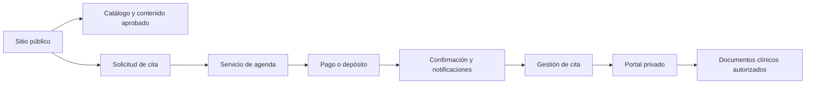

# 03. Arquitectura funcional

## 3.1 Separación de capas

La demo local solo cubre la primera capa y una simulación de solicitud. Cada flecha posterior requiere backend, autorización, persistencia y pruebas específicas.

## 3.2 Módulo A: sitio público

| Área | Responsabilidad | Implementación local | Evolución propuesta |
| --- | --- | --- | --- |
| Inicio | Propuesta, CTA y expectativas | Hero y métricas demostrativas en `App.tsx` | Contenido aprobado, SEO y analítica con consentimiento. |
| Enfoque | Filosofía y límites | Manifiesto y tres pilares | Revisión editorial y clínica; evitar promesas absolutas. |
| Servicios | Explicar alternativas | Cuatro tratamientos locales con selector | Catálogo versionado, indicaciones, contraindicaciones y CTA. |
| Especialistas | Presentar perfiles | Tres perfiles ficticios | Solo profesionales reales con permiso, credenciales verificadas y fecha de revisión. |
| Espacio | Comunicar ambiente | Tres imágenes y métricas conceptuales | Evitar confundir imagen de referencia con sede real. |
| FAQ | Responder dudas | Acordeón local | Respuestas aprobadas; separar información general de consejo clínico. |
| Contacto | Recoger una solicitud mínima | Formulario en memoria | Endpoint protegido, consentimiento y política de privacidad antes de persistir. |

## 3.3 Módulo B: reservas

### Recorrido funcional

| Paso | Entrada | Validación mínima | Estado si falla |
| --- | --- | --- | --- |
| 1. Motivo | Motivo de consulta | Valor del catálogo vigente | Mostrar opciones válidas; no diagnosticar. |
| 2. Servicio | Servicio elegido | Servicio activo y visible | Rechazar servicio retirado. |
| 3. Especialista | Profesional opcional o seleccionado | Especialista habilitado para el servicio | Recalcular disponibilidad. |
| 4. Fecha | Día local de la sede | Fecha futura y dentro del calendario | Informar días no disponibles. |
| 5. Hora | Franja disponible | Duración, zona horaria y capacidad | Revalidar antes de bloquear. |
| 6. Datos | Identidad y contacto mínimos | Formato, consentimiento y duplicados | No crear paciente parcial sin política definida. |
| 7. Preferencias | Preferencias sensoriales opcionales | Longitud y clasificación de sensibilidad | Separar preferencia operativa de dato clínico. |
| 8. Resumen | Cita, coste, duración y política | Coincidencia con servidor | El servidor es la fuente final. |
| 9. Condiciones | Aceptación versionada | Versión y timestamp | No avanzar sin aceptación requerida. |
| 10. Pago | Tarjeta, wallet o garantía | Resultado del proveedor y webhook | Mantener estado pendiente; no confirmar por el cliente. |
| 11. Confirmación | Código y canales | Reserva confirmada por servidor | Generar notificación y token de gestión. |

La interfaz de Stitch muestra pasos, especialistas, fechas, preferencias y un depósito de 90 €. Ese importe es **dato observado en el diseño**, no una política aprobada.

## 3.4 Módulo C: pagos

El producto debe distinguir:

- **Intento de pago**: operación iniciada en un proveedor.
- **Pago autorizado**: proveedor confirmó autorización, pero puede requerir captura.
- **Pago capturado**: importe cobrado.
- **Garantía/depósito**: importe bloqueado o cobrado según contrato aprobado.
- **Aplicación al tratamiento**: regla contable que debe existir en backend, no en la interfaz.
- **Reembolso**: operación posterior con referencia al pago original.

No se documenta una política comercial definitiva porque Stitch contiene variantes de depósito, deducción y reembolso. Las contradicciones se registran en `09-riesgos-e-inconsistencias.md`.

## 3.5 Módulo D: confirmaciones

Una confirmación válida debe incluir únicamente datos necesarios:

- identificador no predecible de la reserva;
- fecha, hora, duración y zona horaria;
- sede aprobada;
- instrucciones operativas aprobadas;
- estado del pago sin exponer datos de tarjeta;
- acciones de calendario, reprogramación o cancelación sujetas a autorización.

El QR no debe contener historia clínica, diagnóstico, teléfono, correo ni un identificador secuencial. Debe transportar un token revocable y de vida limitada, validado en servidor.

Google Wallet, Apple Wallet, email, SMS y WhatsApp son integraciones externas; en la demo son solo conceptos visuales.

## 3.6 Módulo E: gestión de citas

Las operaciones son mutaciones sobre una reserva existente:

- consultar estado;
- solicitar reprogramación;
- confirmar nueva franja;
- cancelar conforme a una política aprobada;
- liberar la franja anterior solo después de confirmar la nueva o cancelar;
- impedir doble reserva mediante una restricción transaccional.

Una vista de gestión nunca debe confiar solo en un ID recibido del navegador. Debe validar posesión de la cita, token o sesión, versión del recurso y reglas de tiempo en servidor.

## 3.7 Módulo F: portal del paciente

El portal separa datos operativos y clínicos:

- acceso y recuperación;
- verificación de identidad y sesión;
- perfil mínimo;
- citas y pagos;
- tratamientos y prescripciones;
- documentos, radiografías y escaneos 3D;
- preferencias y consentimientos.

El usuario autenticado no obtiene acceso global: cada recurso se filtra por paciente y por autorización del profesional. El visor clínico debe usar URLs firmadas, expiración y controles de descarga/exportación definidos.

## 3.8 Responsabilidades de frontend y backend

| Responsabilidad | Frontend | Backend |
| --- | --- | --- |
| Presentar catálogo | Sí, con caché controlada | Fuente de catálogo y versión. |
| Validación de formato | Sí, para feedback | Sí, como control de seguridad y negocio. |
| Disponibilidad | Puede previsualizar | Decide disponibilidad definitiva. |
| Precio/depósito | Presenta una cotización | Calcula y persiste la versión aplicada. |
| Pago | Inicia el flujo seguro | Recibe webhook y cambia estado. |
| Autorización | Oculta acciones no aplicables | Impone permisos en cada recurso. |
| Documentos clínicos | Renderiza de forma segura | Autoriza, firma URLs y audita acceso. |
| Notificación | Muestra estado | Envía, reintenta y registra resultado. |

