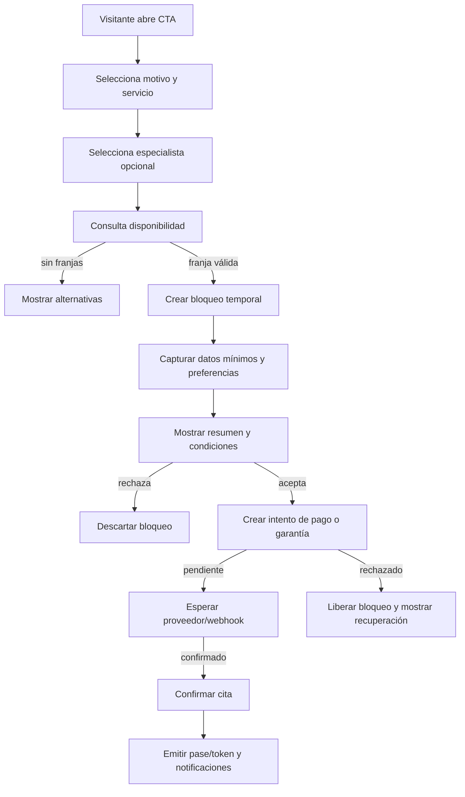
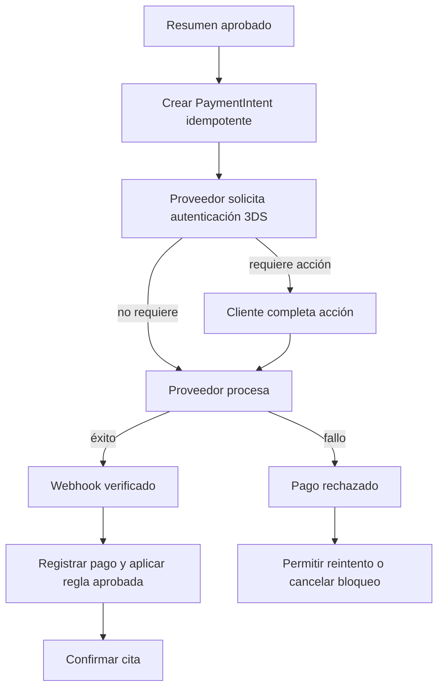
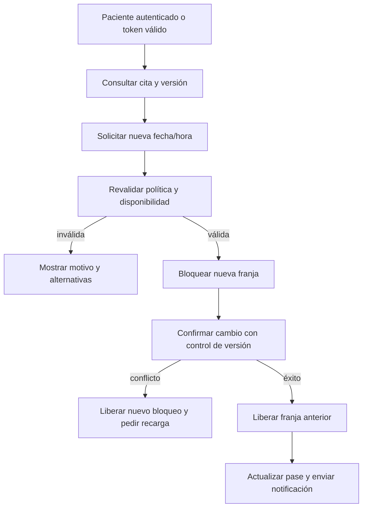
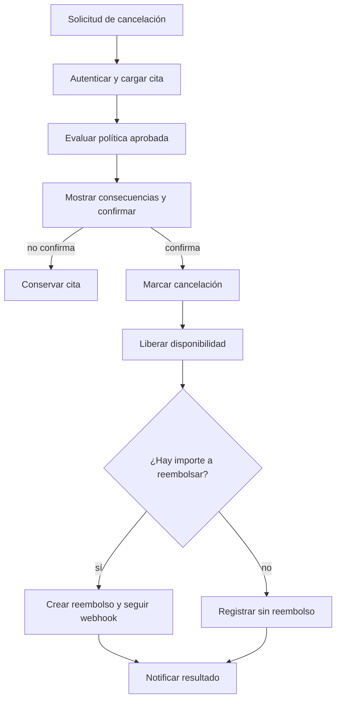
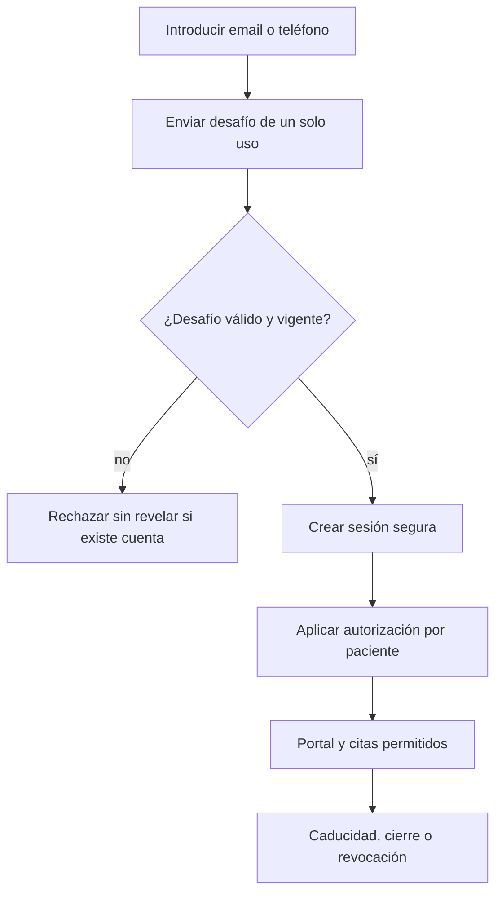

# 04. Flujos y estados

## 4.1 Nueva reserva

La confirmación debe depender de un evento de backend o una respuesta verificada del proveedor, nunca de un botón que el cliente pueda falsificar.

## 4.2 Pago

## 4.3 Reprogramación

## 4.4 Cancelación

## 4.5 Autenticación del paciente

## 4.6 Estados propuestos

### Cita

| Estado | Puede pasar a | Condición |
| --- | --- | --- |
| `draft` | `held`, `cancelled` | Datos locales aún incompletos. |
| `held` | `pending_payment`, `expired`, `cancelled` | Franja bloqueada con TTL. |
| `pending_payment` | `confirmed`, `payment_failed`, `expired` | Intento pendiente. |
| `confirmed` | `reschedule_pending`, `cancelled`, `completed`, `no_show` | Reserva aceptada por servidor. |
| `reschedule_pending` | `confirmed`, `cancelled` | Nueva franja en proceso. |
| `completed` | `closed` | Cierre administrativo posterior. |
| `cancelled` | `refunded` o `closed` | Depende de la política y del pago. |

### Pago

`created → requires_action → authorized → captured → partially_refunded/refunded` y ramas `failed`, `cancelled`, `disputed`.

### Sesión

`requested → challenged → authenticated → active → expired/revoked`.

### Notificación

`queued → sent → delivered` o `failed → retry_exhausted`, con contenido versionado y sin datos clínicos innecesarios.

## 4.7 Estados que la demo local sí representa

- Formulario vacío, errores de validación y confirmación demostrativa.
- Menú abierto/cerrado.
- Tratamiento activo.
- FAQ abierto/cerrado.

La demo no representa los estados de reserva, pago, sesión, portal ni notificaciones anteriores.

