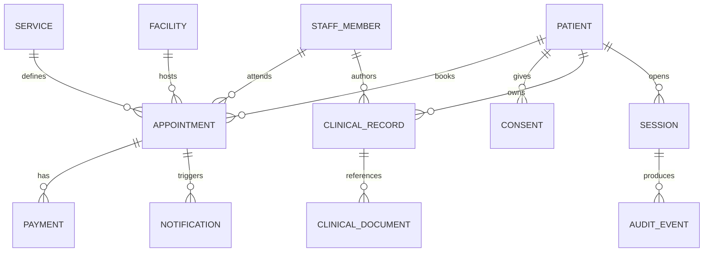

# 06. Modelo conceptual de datos

Este documento define conceptos y límites; no crea tablas, migraciones ni una base de datos.

## 6.1 Entidades principales

| Entidad | Propósito | Datos sensibles | Retención/propietario pendiente |
| --- | --- | --- | --- |
| `Patient` | Identidad y datos de contacto | Puede vincularse a salud | Responsable clínico/legal. |
| `PatientPreference` | Preferencias operativas/sensoriales | Algunas notas pueden revelar salud | Minimizar y separar de historia clínica. |
| `StaffMember` | Profesional o personal interno | Credenciales profesionales | Verificación y ciclo de vida. |
| `Service` | Catálogo y duración | No por sí sola | Negocio + revisión clínica. |
| `AvailabilityRule` | Horarios y excepciones | No por sí sola | Operaciones. |
| `Room/Facility` | Sede, gabinete y recursos | Ubicación operativa | Negocio. |
| `Appointment` | Reserva y su estado | Puede revelar atención sanitaria | Historia operativa y auditoría. |
| `AppointmentHold` | Bloqueo temporal | No por sí sola | TTL corto. |
| `Payment` | Intento, captura, reembolso | No almacenar datos de tarjeta | Proveedor + contabilidad. |
| `Consent` | Consentimientos y versiones | Puede incluir salud/privacidad | Responsable del tratamiento. |
| `ClinicalRecord` | Evolución, diagnóstico o tratamiento | Sí, datos sanitarios | Requisitos profesionales y legales. |
| `ClinicalDocument` | PDF, radiografía, DICOM, STL, escaneo | Sí | Almacenamiento clínico seguro. |
| `Prescription` | Prescripción y pauta | Sí | Profesional y paciente. |
| `Notification` | Entrega de correo/SMS/push | Debe minimizar contenido | Proveedor y política de comunicaciones. |
| `AuditEvent` | Rastro de acciones sensibles | Puede contener metadatos personales | Retención de seguridad. |
| `AccessGrant/Session` | Sesión y autorización | Tokens y metadatos | Expiración y revocación. |

## 6.2 Relaciones

## 6.3 Invariantes

1. Un paciente solo puede consultar citas y documentos que le pertenecen, salvo autorización explícita y auditable.
2. Una cita debe referenciar un servicio y una sede vigentes; especialista y sala se validan según reglas de disponibilidad.
3. Un documento clínico no se sirve desde una URL pública ni con un token permanente.
4. Un pago nunca almacena PAN/CVV; solo referencias del proveedor, estado, importe, moneda y conciliación.
5. Un evento de auditoría no se edita para ocultar una acción; cualquier corrección genera otro evento.
6. Una sesión expira y puede revocarse independientemente de la cita.
7. Los QR y pases usan identificadores aleatorios, con expiración y revocación.

## 6.4 Separación de datos

- **Público**: contenido de servicios, preguntas generales y CTA.
- **Operativo**: contacto, agenda, estado de cita y pagos mínimos.
- **Clínico**: historia, imágenes, prescripciones, informes y preferencias con posible relación sanitaria.
- **Seguridad**: sesiones, desafíos, auditoría y referencias de integración.

El frontend público no debe recibir el conjunto clínico. El portal debe pedir cada recurso de forma autorizada y registrar acceso sensible.

## 6.5 Identificadores y trazabilidad

- IDs internos aleatorios, no secuenciales cuando sean expuestos.
- `publicBookingCode` separado del ID interno y revocable.
- `providerReference` para pagos sin datos de tarjeta.
- `policyVersion`, `consentVersion` y `contentVersion` para saber qué aceptó o vio el usuario.
- `createdAt`, `updatedAt`, `effectiveAt` y zona horaria explícita en citas y políticas.

## 6.6 Evolución por etapa

### Demo

Sin persistencia. Los tipos locales de `AppointmentForm` representan solo nombre, correo, interés y mensaje.

### MVP

Entidades de paciente/contacto mínimo, servicio, disponibilidad, cita, bloqueo, pago referenciado, consentimiento y notificación. No incorporar historia clínica si no existe gobierno de datos.

### Producción clínica

Añadir historial, documentos, prescripciones, auditoría completa, controles por rol, retención, recuperación y visor clínico tras evaluación de riesgo y requisitos profesionales.

