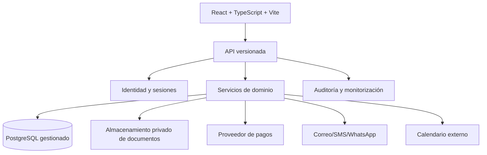

# 07. Arquitectura técnica propuesta

## 7.1 Estado técnico actual

| Capa | Evidencia | Estado |
| --- | --- | --- |
| UI | React 19 + TypeScript en `src/App.tsx` | Una página y estado local. |
| Build | Vite 8, plugin oficial de React | Configurado en `vite.config.ts`. |
| CSS | Tailwind v4 importado en `src/styles.css` y CSS editorial en `src/studio.css` | Sin pipeline de diseño remoto en ejecución. |
| Assets | WebP, TTF y CSS de fuentes bajo `src/assets/` | Importados localmente. |
| Validación | `src/lib/validation.ts` | Reglas mínimas de nombre, email, motivo y longitud. |
| Pruebas | Vitest + jsdom | Dos pruebas unitarias de validación; no cubren UI. |
| Backend | Ninguno | No hay API, autenticación ni persistencia. |
| Integraciones | Ninguna local | Stitch exportado contiene URLs de demostración, no contratos activos. |

La exportación HTML de Stitch usa CDN de Tailwind, Google Fonts, Material Symbols y URLs privadas de imágenes. Es una fuente visual, no una dependencia que deba copiarse a producción. La aplicación local ya evita esas dependencias de ejecución para las fuentes e imágenes.

## 7.2 Arquitectura objetivo por capas

Recomendación: empezar con un **monolito modular TypeScript** detrás de una API HTTP, no con microservicios. La separación interna por módulos permite evolucionar sin distribuir prematuramente los datos clínicos y las transacciones.

## 7.3 Alternativas y recomendación

| Decisión | Alternativas | Recomendación | Motivo y limitación |
| --- | --- | --- | --- |
| Backend | Monolito modular, serverless disperso, microservicios | Monolito modular TypeScript | Transacciones de agenda/pago más simples; requiere disciplina de módulos. |
| API | REST, GraphQL, BaaS | REST versionada para comandos y consultas | Contratos explícitos y fácil auditoría; requiere diseñar paginación y errores. |
| Datos | PostgreSQL, NoSQL, BaaS | PostgreSQL gestionado | Restricciones, transacciones y consultas de agenda; exige copias y migraciones revisadas. |
| Identidad | Proveedor OIDC, sesiones propias, passwordless | Proveedor OIDC o servicio gestionado con sesión HTTP-only | Reduce superficie de contraseñas; hay dependencia y coste de proveedor. |
| Archivos clínicos | Object storage privado, sistema DICOM especializado, filesystem | Object storage privado para documentos; DICOM/visor especializado separado | URLs firmadas y escalabilidad; DICOM requiere validación clínica y de interoperabilidad. |
| Pagos | PSP con hosted fields, factura manual, BaaS | PSP con 3DS y webhooks | No tocar datos de tarjeta; depende de disponibilidad y conciliación. |
| Notificaciones | Proveedor transaccional, SMTP propio, WhatsApp | Proveedor transaccional con plantillas versionadas | Rebotes, reintentos y trazabilidad; revisar transferencia internacional. |
| Calendario | Agenda propia, Google/Microsoft, proveedor sanitario | Fuente de verdad propia + adaptador externo si se aprueba | Evita doble reserva; sincronización añade conflictos. |
| Visor | Previsualización de PDF, DICOM viewer, 3D viewer | Empezar por descarga/preview segura; evaluar visor clínico después | Un visor no sustituye autorización, auditoría ni validación médica. |
| Despliegue | VPS, cloud gestionado, PaaS | Entorno gestionado con regiones y controles contractuales adecuados | Menor operación inicial; hay lock-in y revisión de residencia de datos. |

No se seleccionan proveedores concretos ni se estiman costes en esta fase porque los precios, regiones y condiciones cambian y todavía faltan país, volumen, responsable del tratamiento y requisitos de integración.

## 7.4 Contrato de API inicial

La API debe usar recursos plurales, errores estables y autenticación/autorización separadas.

| Método | Recurso | Uso |
| --- | --- | --- |
| `GET` | `/api/v1/services` | Catálogo publicado y versionado. |
| `GET` | `/api/v1/availability` | Franjas calculadas para servicio, sede y rango. |
| `POST` | `/api/v1/appointment-holds` | Crear bloqueo idempotente. |
| `POST` | `/api/v1/appointments` | Crear reserva desde un bloqueo válido. |
| `GET` | `/api/v1/me/appointments` | Citas del paciente autenticado. |
| `POST` | `/api/v1/appointments/{id}/reschedule` | Solicitar cambio con versión y nueva franja. |
| `POST` | `/api/v1/appointments/{id}/cancellation` | Solicitar cancelación y cálculo de consecuencia. |
| `POST` | `/api/v1/payment-intents` | Crear intento de pago sin datos de tarjeta. |
| `POST` | `/api/v1/webhooks/payments/{provider}` | Recibir evento firmado e idempotente. |
| `GET` | `/api/v1/me/documents` | Listar documentos autorizados sin exponer URLs permanentes. |
| `GET` | `/api/v1/documents/{id}/download` | Emitir acceso corto tras autorización. |

Los comandos mutables deben aceptar una clave de idempotencia, devolver `409` ante conflicto de versión y no filtrar stack traces, SQL, tokens ni rutas internas. Las listas deben tener límites y orden estable.

## 7.5 Frontend futuro

- Mantener React + TypeScript + Vite si el equipo no necesita SSR.
- Separar componentes públicos, reservas, autenticación, portal y componentes de contenido.
- Mantener estado de formulario cerca del flujo; usar un cliente de datos solo cuando exista API real.
- No poner tokens en `localStorage` por comodidad.
- Modelar estados de carga, error, vacío, expiración y reintento.
- Mantener tipografías y assets locales sin URLs privadas de Stitch.

## 7.6 Entornos y operación

| Entorno | Datos | Objetivo |
| --- | --- | --- |
| Local/demo | Ficticios, sin servicios clínicos | Desarrollo y portafolio. |
| Staging | Datos sintéticos, proveedores sandbox | Integración y QA. |
| Producción | Datos reales mínimos y protegidos | Atención clínica bajo controles aprobados. |

Cada entorno necesita secretos separados, configuración validada al inicio, logs con redacción, alertas, copias cifradas, prueba de restauración y procedimiento de incidente.

