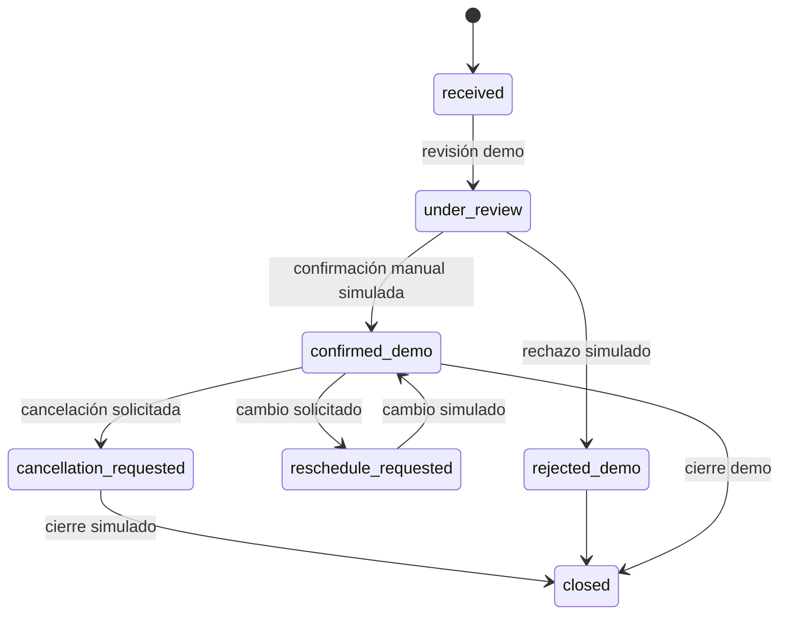

# 13. Especificación funcional para aprobación

## Estado de cierre

La especificación funcional del MVP-1 queda **APROBADA** en cuanto a alcance. Los detalles de contenido, datos operativos, proveedores y la implementación técnica siguen **PROPUESTOS** o **PENDIENTES** según la tabla. Este documento no autoriza modificar código, instalar dependencias, crear backend, configurar bases de datos ni conectar servicios externos.

## Contexto aprobado

| Decisión | Estado |
| --- | --- |
| Demo preparada para comercialización | **APROBADO** |
| País de referencia: Perú | **APROBADO** |
| Moneda: PEN | **APROBADO** |
| Zona horaria: `America/Lima` | **APROBADO** |
| Datos ficticios | **APROBADO** |
| Separación demo/futura operación comercial | **APROBADO** |

## Alcance funcional aprobado

| Área | Alcance | Estado |
| --- | --- | --- |
| Sitio público | Landing, servicios, especialistas demostrativos, instalaciones, FAQ, contacto, SEO y accesibilidad | **APROBADO** |
| Solicitudes | Servicio, especialista, preferencia de fecha/hora, disponibilidad y solicitud de cita | **APROBADO** |
| Administración | Inicio de sesión aislado, solicitudes, servicios, especialistas, horarios, estados y auditoría | **APROBADO** |
| Confirmación | Confirmación manual, reprogramación y cancelación controladas | **APROBADO** |
| Notificaciones | Simulación de confirmaciones y cambios, sin envío real | **APROBADO** |
| Pagos | Sin transacciones ni depósitos reales; cualquier pago futuro sería simulado | **APROBADO como exclusión** |
| Portal clínico | Sin historia, radiografías, escaneos, prescripciones ni documentos sanitarios | **APROBADO como exclusión** |

## 1. Roles de demostración

| Rol | Permisos | Estado |
| --- | --- | --- |
| Visitante | Leer el sitio y crear una solicitud ficticia | **APROBADO** |
| Administrador demo | Revisar solicitudes y gestionar fixtures autorizados | **APROBADO** |
| Especialista demo | Perfil demostrativo sin acceso independiente | **APROBADO** |
| Paciente | No existe portal clínico | **APROBADO como exclusión** |

## 2. Requisitos funcionales

### Sitio público

| ID | Requisito | Criterio de aceptación | Estado |
| --- | --- | --- | --- |
| FR-001 | Mostrar landing con hero, servicios, especialistas, instalaciones, FAQ y contacto | Se recorren las secciones con navegación válida y contenido demo | **APROBADO** |
| FR-002 | Mantener identidad Warm Editorial Atelier | Se conservan paleta, tipografía, composición y responsive aprobados | **APROBADO** |
| FR-003 | Ofrecer SEO básico sin sede real inventada | No aparecen ciudad, dirección ni claims no aprobados | **APROBADO** |
| FR-004 | Ser accesible con teclado y móvil | Menú, FAQ, tabs, formularios y foco tienen estados verificables | **APROBADO** |
| FR-005 | Identificar perfiles y datos ficticios | Ningún profesional o clínica demo se presenta como real | **APROBADO** |

### Catálogo y especialistas

| ID | Requisito | Criterio de aceptación | Estado |
| --- | --- | --- | --- |
| FR-010 | Gestionar servicios demo | Crear, editar y publicar fixtures aislados | **APROBADO** |
| FR-011 | Mostrar servicios ficticios aprobados | No aparecen precios, duraciones o claims pendientes | **APROBADO** |
| FR-012 | Gestionar especialistas ficticios | El perfil lleva etiqueta demo y no afirma credenciales reales | **APROBADO** |
| FR-013 | Mantener procedencia de recursos visuales | Imágenes y fuentes tienen documentación local | **APROBADO** |

El catálogo, los nombres, las duraciones y las credenciales concretas siguen **PENDIENTES** como contenido.

### Solicitud y reserva demostrativa

| ID | Requisito | Criterio de aceptación | Estado |
| --- | --- | --- | --- |
| FR-020 | Permitir solicitud de cita ficticia | Queda en estado demo y no se envía a una clínica real | **APROBADO** |
| FR-021 | Seleccionar servicio y especialista | Solo se aceptan fixtures publicados | **APROBADO** |
| FR-022 | Indicar preferencia de fecha y horario | Usa `America/Lima` y se identifica como preferencia | **APROBADO** |
| FR-023 | Validar disponibilidad | Muestra fixtures y no afirma agenda comercial real | **APROBADO** |
| FR-024 | Confirmar manualmente | La etiqueta indica confirmación demostrativa | **APROBADO** |
| FR-025 | Solicitar reprogramación y cancelación | Son estados controlados, sin reembolso ni efecto económico | **APROBADO** |

### Panel administrativo

| ID | Requisito | Criterio de aceptación | Estado |
| --- | --- | --- | --- |
| FR-030 | Inicio de sesión administrativo aislado | No acepta credenciales reales ni comparte producción | **APROBADO** |
| FR-031 | Gestionar solicitudes ficticias | Permite revisar estados permitidos | **APROBADO** |
| FR-032 | Gestionar servicios y especialistas ficticios | Solo afecta datos demo | **APROBADO** |
| FR-033 | Configurar horarios ficticios | Usa `America/Lima` y etiqueta de ejemplo | **APROBADO** |
| FR-034 | Registrar acciones administrativas | Incluye actor demo y momento de prueba | **APROBADO** |

Los permisos exactos, roles técnicos y duración de sesiones son **PROPUESTOS** en `17` y requieren revisión antes de implementar.

### Notificaciones

| ID | Requisito | Criterio de aceptación | Estado |
| --- | --- | --- | --- |
| FR-040 | Simular confirmaciones y cambios | El mensaje aparece dentro de la demo | **APROBADO** |
| FR-041 | No activar correo, SMS o WhatsApp reales | No hay proveedor, credenciales ni endpoint operativo | **APROBADO** |

### Pagos y portal clínico excluidos

| ID | Requisito | Criterio de aceptación | Estado |
| --- | --- | --- | --- |
| FR-050 | No realizar transacciones reales | No hay checkout, proveedor ni tarjeta | **APROBADO** |
| FR-051 | No tratar 90 € como precio aprobado | No se muestra ni se convierte a PEN | **APROBADO** |
| FR-052 | Excluir información clínica | No hay vistas ni almacenamiento sanitario | **APROBADO** |

## 3. Datos permitidos y prohibidos

La demo usa fixtures ficticios. El formulario no debe solicitar ni conservar DNI, diagnósticos, antecedentes médicos, medicamentos, radiografías, escaneos 3D, prescripciones, información médica, datos de tarjeta ni información de terceros o menores.

Si se habilita recopilación real, requiere una aprobación específica de privacidad, seguridad y normativa peruana aplicable.

## 4. Estados funcionales

Estos estados no representan reservas, pagos ni atención clínica reales.

## 5. Decisiones no cerradas por esta aprobación

| Tema | Estado | Responsable |
| --- | --- | --- |
| Ciudad y sede | **PENDIENTE** | PO + operaciones |
| Catálogo, claims, duraciones y horarios | **PENDIENTE** | PO + clínico + operaciones |
| Precios y política de cancelación | **PENDIENTE** | PO + operaciones + contabilidad |
| Profesionales y credenciales | **PENDIENTE** | PO + clínico |
| Framework, ORM, infraestructura y proveedores | **PROPUESTO/PENDIENTE** | PO + técnico |
| Privacidad para datos reales | **PENDIENTE** | PO + privacidad/legal |

## 6. Puertas de control

| Puerta | Pregunta | Estado |
| --- | --- | --- |
| G1 | ¿Se aprueba el alcance funcional MVP-1? | **APROBADO** |
| G2 | ¿Se usan solo fixtures ficticios y aislamiento demo/comercial? | **APROBADO** |
| G3 | ¿Se aprueban catálogo, especialistas y copy concretos? | **PENDIENTE** |
| G4 | ¿Se aprueba la arquitectura técnica y sus dependencias exactas? | **PENDIENTE** |
| G5 | ¿Se aprueban privacidad, proveedores y operación comercial? | **PENDIENTE** |
| G6 | ¿Se autoriza iniciar implementación? | **PENDIENTE** |

