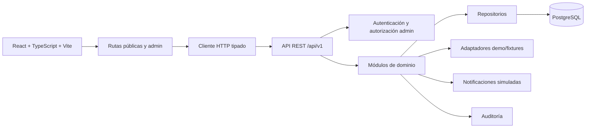

# 14. Arquitectura técnica definitiva recomendada

## Estado

Documento técnico de la Fase 3 para iniciar la implementación después de la aprobación correspondiente. La arquitectura está seleccionada como recomendación; no se ha implementado, instalado ni conectado ningún servicio.

## 1. Auditoría técnica del estado actual

| Área | Evidencia local | Decisión de evolución |
| --- | --- | --- |
| Frontend | React 19, TypeScript, Vite, una función `App` monolítica | Conservar React + TypeScript + Vite; separar por módulos sin rehacer la identidad visual. |
| Estilos | Tailwind v4 importado y CSS editorial en `studio.css`; `styles.css` conserva reglas heredadas | Mantener el sistema Warm Editorial Atelier; limpiar o reorganizar solo durante implementación autorizada. |
| Estado | `useState` para menú, tabs, FAQ y formulario | Mantener estado local; añadir hooks de servidor cuando exista API. |
| Formularios | `validateAppointmentForm`, `preventDefault()` y dos tests unitarios | Conservar la validación como base; añadir contratos de API y mensajes accesibles. |
| Datos | Fixtures escritos en `App.tsx`; 11 imágenes locales y fuentes TTF locales | Extraer fixtures a un módulo versionado y marcado como demo. |
| Rutas | Anclas HTML; no hay router ni rutas administrativas | Añadir rutas públicas y administrativas cuando se implemente el MVP. |
| Backend | No existe carpeta de servidor ni API | Crear un backend separado por módulos, fuera de `src/` público. |
| Persistencia | No existe base de datos ni migración | Evaluar PostgreSQL y migraciones versionadas antes de persistencia. |
| Autenticación | No existe | Crear solo autenticación administrativa; no portal de pacientes en MVP-1. |
| Tests | Vitest/jsdom, dos pruebas de validación | Ampliar a componentes, API, reglas de disponibilidad y autorización. |
| Dependencias | React, React DOM, Lucide en producción; Vite/Tailwind/Vitest/jsdom/tipos en desarrollo | No instalar ahora; revisar cada dependencia antes de implementar. |

## 2. Comparación de arquitecturas

| Opción | Ventajas | Costes/riesgos | Decisión |
| --- | --- | --- | --- |
| Monolito tradicional | Inicio rápido y pocas piezas | Mezcla UI, negocio y persistencia; difícil aislar seguridad | No recomendado. |
| Monolito modular con API | Límites claros, transacciones simples, operación razonable y evolución gradual | Requiere disciplina de dependencias internas | **Seleccionado**. |
| Microservicios | Escalado y despliegue independiente por dominio | Coste operativo, observabilidad y consistencia innecesarios para este MVP | Posponer. |

La solución definitiva recomendada es un **monolito modular de backend con API REST versionada y frontend React separado**. El backend se despliega como una unidad, pero sus módulos no comparten lógica arbitrariamente.

## 3. Arquitectura general

## 4. Stack seleccionado

| Capa | Selección | Justificación |
| --- | --- | --- |
| Frontend | React + TypeScript + Vite | Ya existe, es adecuado para SPA y conserva la inversión visual. |
| CSS | Tailwind CSS v4 + CSS editorial existente | Mantiene integración actual e identidad de Stitch sin segunda pipeline. |
| Iconos | Lucide React existente | Evita introducir otra biblioteca de iconos. |
| Rutas frontend | Router declarativo para separar público/admin | Permite protección de rutas y deep links; revisar dependencia antes de instalar. |
| Estado UI | Estado local y hooks propios | Evita una store global prematura. |
| Cliente HTTP | `fetch` encapsulado en un cliente pequeño | No añade una dependencia para una API inicial acotada. |
| Backend | Node.js LTS + TypeScript + Fastify | Rendimiento suficiente, esquemas de ruta, plugins y buena separación HTTP/dominio. |
| Contratos | JSON Schema en borde + OpenAPI como documentación | Validación y contrato sin duplicar reglas de negocio. |
| Base de datos | PostgreSQL | Transacciones, relaciones, restricciones y exclusión de rangos para agenda. |
| Acceso a datos | Drizzle ORM con migraciones SQL revisables | Tipado cercano a SQL, control explícito de índices y restricciones; no oculta invariantes de agenda. |
| Sesiones | Sesiones administrativas server-side en cookie segura | Revocación sencilla; evita JWT en `localStorage`. |
| Hash | Argon2id mediante librería revisada durante instalación | Resistente a ataques de contraseñas; no se almacenan credenciales en el repositorio. |
| Auditoría | Tabla `audit_events` y logger estructurado | Trazabilidad de acciones administrativas sin guardar cuerpos completos. |
| Notificaciones MVP | Eventos persistidos con canal `simulated` | Permite demostrar el flujo sin correo/SMS/WhatsApp reales. |
| Observabilidad | Logs estructurados, health checks y métricas mínimas | Diagnóstico sin introducir una plataforma externa todavía. |

Drizzle, Fastify, el router y Argon2id son decisiones de arquitectura, no instalaciones autorizadas. Cada paquete deberá revisarse contra el `package.json` y el lockfile antes de incorporarse.

## 5. Límites de responsabilidad

- **Frontend**: presentación, interacción, validación de experiencia y estados de carga/error.
- **API**: autenticación, autorización, validación de contrato y serialización.
- **Dominio**: reglas de disponibilidad, estados y transiciones.
- **Repositorios**: consultas y persistencia; no deciden copy ni permisos.
- **Base de datos**: integridad, unicidad, timestamps y no solapamiento.
- **Adaptadores**: fixtures demo y futuros proveedores, intercambiables por configuración.

## 6. Demo frente a operación comercial

| Aspecto | Demo | Comercial futura |
| --- | --- | --- |
| Datos | Fixtures ficticios | Datos reales con aprobación de privacidad. |
| Agenda | Disponibilidad configurable simulada | Fuente de verdad transaccional. |
| Confirmaciones | Eventos simulados | Canal transaccional aprobado. |
| Pagos | Excluidos o simulados | Proveedor aprobado y webhooks. |
| Auth | Admin demo aislado | Sesiones y controles operativos reales. |
| DB | Fixture repository o PostgreSQL aislado | PostgreSQL gestionado con backups. |
| Configuración | `DEMO_MODE=true` | `DEMO_MODE=false` solo con checklist de salida. |

## 7. Criterios de preparación para implementación

1. Aprobar este stack y las dependencias nuevas por separado.
2. Crear módulos backend sin tocar la landing hasta definir rutas de integración.
3. Diseñar migraciones y revisar SQL antes de ejecutarlas.
4. Mantener la demo sin datos reales y con adaptadores simulados.
5. Implementar pruebas de invariantes antes de activar disponibilidad mutable.

