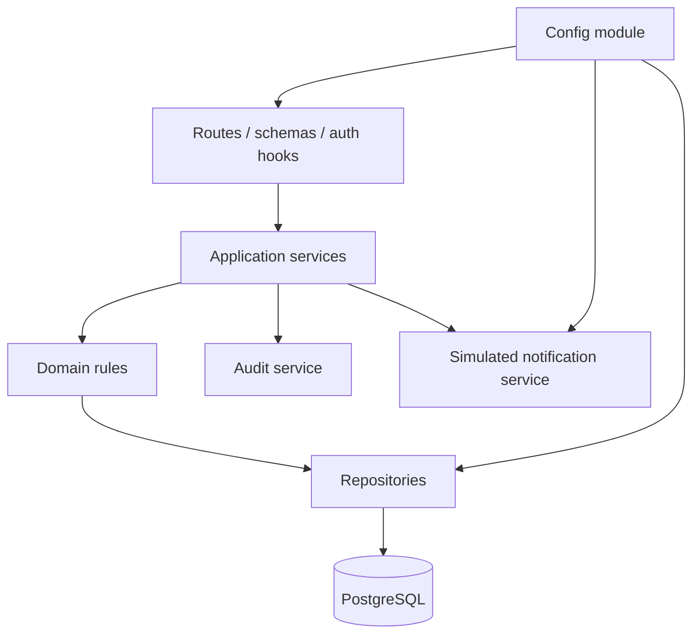

# 15. Arquitectura backend y contratos API

## Estado

Diseño de contratos para el MVP-1 aprobado funcionalmente. Los endpoints no están implementados y no se ha ejecutado ninguna migración ni servidor.

## 1. Organización modular



Dependencias permitidas: `routes → application → domain → repositories`. Los módulos no importan rutas de otros módulos ni acceden directamente a la conexión fuera de repositorios.

## 2. Módulos del backend

| Módulo | Responsabilidad | Entidades | Operaciones principales |
| --- | --- | --- | --- |
| `config` | Validar configuración y modo demo | `ClinicConfiguration` | Cargar variables, rechazar secretos ausentes. |
| `auth` | Login, logout y sesión administrativa | `AdminUser`, `AdminSession` | Crear/revocar sesión, obtener usuario actual. |
| `services` | Catálogo publicado y administración | `Service` | Listar público, crear/editar/publicar admin. |
| `professionals` | Perfiles demostrativos | `Professional` | Listar público, CRUD admin. |
| `availability` | Reglas, bloqueos y franjas simuladas | `AvailabilityRule`, `BlockedTime`, `Appointment` | Calcular, bloquear, revalidar. |
| `appointment-requests` | Solicitudes públicas y estados | `AppointmentRequest` | Crear, listar, revisar, rechazar. |
| `appointments` | Confirmación y cambios controlados | `Appointment` | Confirmar manualmente, solicitar cambio/cancelación. |
| `admin` | Agregación de vistas operativas | Proyecciones de módulos | Resúmenes paginados y acciones autorizadas. |
| `notifications` | Simular eventos de comunicación | `NotificationEvent` | Crear, listar, marcar simulación. |
| `audit` | Registrar acciones sensibles | `AuditEvent` | Escribir y consultar según permiso. |

## 3. Contrato de errores

Todas las respuestas de error usarán un envelope estable:

```json
{
  "type": "https://example.invalid/problems/validation-error",
  "title": "La solicitud no es válida",
  "status": 422,
  "code": "VALIDATION_ERROR",
  "detail": "Revisa los campos indicados.",
  "fieldErrors": {
    "serviceId": "El servicio no está publicado."
  },
  "requestId": "req_demo_01"
}
```

En implementación se sustituirá el dominio de ejemplo por uno aprobado. Nunca se incluyen stack traces, SQL, rutas internas, secretos ni valores de cookies.

## 4. Endpoints públicos

Base: `/api/v1`.

| Método y ruta | Auth | Request/params | Response | Errores principales |
| --- | --- | --- | --- | --- |
| `GET /services` | No | `status=published`, `cursor`, `limit` máximo configurado | Lista paginada de servicios sin datos internos | `400`, `429`, `500`. |
| `GET /professionals` | No | `status=active`, `serviceId` opcional | Lista de perfiles demo publicados | `400`, `404`, `429`. |
| `GET /availability` | No | `serviceId`, `professionalId` opcional, `from`, `to`, `timeZone=America/Lima` | Franjas simuladas con `startsAt`, `endsAt`, `isDemo` | `400`, `404`, `409`, `429`. |
| `POST /appointment-requests` | No | Nombre demo, contacto demo, servicio, profesional opcional, preferencia local | `{ id, status: "received", isDemo: true }` | `400`, `422`, `429`, `503`. |

Reglas públicas:

- solo se aceptan IDs publicados;
- el servidor vuelve a validar longitud, formato y modo demo;
- no se admiten DNI, diagnósticos, medicamentos, archivos ni datos de tarjeta;
- en `DEMO_MODE=true`, la respuesta debe conservar `isDemo=true`;
- los límites y mensajes no deben revelar si existe un contacto real.

### Request de solicitud demo

```json
{
  "displayName": "Paciente Demo",
  "contact": "demo@example.invalid",
  "serviceId": "service-demo-estetica",
  "professionalId": "professional-demo-01",
  "preferredDate": "2030-01-15",
  "preferredTimeStart": "10:00",
  "preferredTimeEnd": "12:00",
  "timeZone": "America/Lima",
  "contactPreference": "simulated"
}
```

Los valores son fixtures de documentación y no representan personas, fechas, precios ni disponibilidad reales.

## 5. Autenticación administrativa

| Método y ruta | Auth | Request | Response | Errores |
| --- | --- | --- | --- | --- |
| `POST /auth/admin/login` | No | `email`, `password`, `csrfToken` cuando corresponda | Cookie de sesión; cuerpo sin secreto | `400`, `401`, `429`. |
| `POST /auth/admin/logout` | Sesión admin | Sin body | `204` | `401`, `403`. |
| `GET /auth/admin/me` | Sesión admin | Ninguno | Usuario, rol y permisos mínimos | `401`, `403`. |

La sesión se mantiene en cookie segura y se revoca en servidor. No se devuelve un JWT para guardarlo en el navegador.

## 6. Endpoints administrativos

| Método y ruta | Auth | Request/params | Response | Errores |
| --- | --- | --- | --- | --- |
| `GET /admin/appointment-requests` | `operator` | `status`, `from`, `to`, `cursor`, `limit` | Lista paginada y redacted | `401`, `403`, `422`. |
| `PATCH /admin/appointment-requests/{id}` | `operator` | `status`, `internalNote` no clínica | Recurso actualizado + `auditEventId` | `401`, `403`, `404`, `409`, `422`. |
| `POST /admin/appointment-requests/{id}/confirm` | `operator` | Servicio/profesional/franja demo | Cita demo confirmada manualmente | `401`, `403`, `404`, `409`, `422`. |
| `POST /admin/appointment-requests/{id}/reschedule` | `operator` | Nueva preferencia demo | Solicitud de cambio simulada | `401`, `403`, `404`, `409`, `422`. |
| `POST /admin/appointment-requests/{id}/cancel` | `operator` | Motivo no clínico | Solicitud cancelada/simulada | `401`, `403`, `404`, `409`, `422`. |
| `GET /admin/services` | `editor` | Filtros y paginación | Servicios incluidos los no publicados | `401`, `403`, `422`. |
| `POST /admin/services` | `editor` | Nombre, slug, descripción, duración demo y estado | Servicio creado | `401`, `403`, `409`, `422`. |
| `PATCH /admin/services/{id}` | `editor` | Campos permitidos y `version` | Servicio actualizado | `401`, `403`, `404`, `409`, `422`. |
| `GET /admin/professionals` | `editor` | Estado y paginación | Perfiles demo | `401`, `403`, `422`. |
| `POST /admin/professionals` | `editor` | Nombre ficticio, especialidad demo, asset local | Perfil creado | `401`, `403`, `422`. |
| `PATCH /admin/professionals/{id}` | `editor` | Campos permitidos y `version` | Perfil actualizado | `401`, `403`, `404`, `409`, `422`. |
| `GET /admin/availability-rules` | `operator` | Profesional y rango | Reglas configurables demo | `401`, `403`, `422`. |
| `POST /admin/availability-rules` | `operator` | Día, hora local, vigencia, zona | Regla creada | `401`, `403`, `409`, `422`. |
| `PATCH /admin/availability-rules/{id}` | `operator` | Campos y `version` | Regla actualizada | `401`, `403`, `404`, `409`, `422`. |
| `GET /admin/notifications` | `operator` | Estado, tipo, cursor, limit | Eventos simulados paginados | `401`, `403`, `422`. |
| `GET /admin/audit-events` | `admin` | Actor, acción, entidad, rango, cursor | Eventos redactados | `401`, `403`, `422`. |

## 7. Códigos HTTP

- `200`: consulta o mutación completada.
- `201`: recurso creado.
- `204`: logout o acción sin cuerpo.
- `400`: JSON o parámetros malformados.
- `401`: sesión ausente o inválida.
- `403`: sesión válida sin permiso.
- `404`: recurso inexistente o no visible para el actor.
- `409`: conflicto de versión, estado o disponibilidad.
- `422`: validación semántica.
- `429`: límite de solicitudes.
- `500`: error inesperado sin detalles internos.
- `503`: dependencia no disponible, sin afirmar confirmación.

## 8. Idempotencia y concurrencia

- Los comandos `confirm`, `reschedule` y `cancel` aceptan `Idempotency-Key`.
- Las mutaciones administrativas incluyen `version` para control optimista.
- La confirmación de cita revalida disponibilidad dentro de una transacción.
- Un conflicto devuelve `409` y no libera ni crea franjas parcialmente.
- Las notificaciones se generan después de persistir la transición y con deduplicación por evento.

