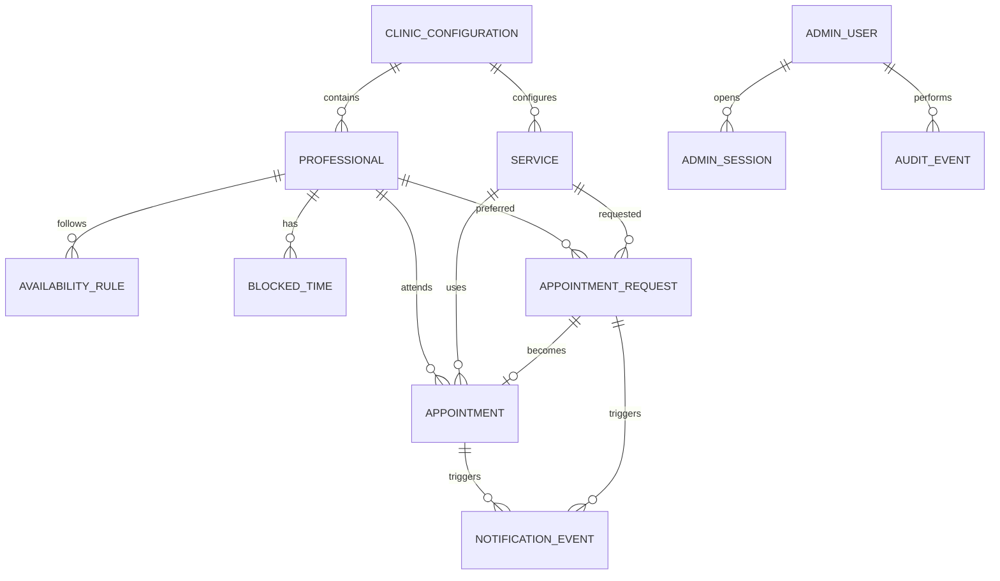

# 16. Modelo de datos y persistencia

## Estado

Modelo recomendado para el MVP-1 aprobado funcionalmente. No se ha creado una base de datos, no se han ejecutado migraciones y no se ha elegido un proveedor de infraestructura.

## 1. Decisión de persistencia

Se recomienda PostgreSQL para la futura operación comercial y un repositorio de demostración aislado para la demo. La aplicación no debe mezclar fixtures demostrativos con datos comerciales.

La capa de persistencia propuesta es un ORM TypeScript con migraciones SQL revisables. Drizzle ORM es la opción recomendada inicialmente por mantener el SQL visible y encajar con un backend modular; la selección definitiva del paquete y su versión requiere revisión de dependencias antes de implementar.

## 2. Entidades propuestas

| Entidad | Campos esenciales | Reglas y límites |
| --- | --- | --- |
| `ClinicConfiguration` | `id`, `countryCode`, `currencyCode`, `timeZone`, `locale`, `demoMode`, timestamps | Valores demo: `PE`, `PEN`, `America/Lima`, `es-PE`, `demoMode=true`. |
| `Service` | `id`, `clinicId`, `slug`, `name`, `description`, `durationMinutes`, `bufferMinutes`, `status`, `demoData`, timestamps | Slug único por clínica. No contiene precios aprobados si todavía no existen. |
| `Professional` | `id`, `clinicId`, `displayName`, `specialty`, `bio`, `imageAssetKey`, `status`, `demoData`, timestamps | Todo perfil presentado en la demo debe identificarse como demostrativo. |
| `AvailabilityRule` | `id`, `clinicId`, `professionalId` opcional, día de semana, hora local inicial/final, vigencia, activo | Las reglas recurrentes se interpretan en `America/Lima`; `end > start`. |
| `BlockedTime` | `id`, clínica/profesional, inicio/fin, motivo, estado, `demoData` | Bloqueo explícito con intervalo válido; no sustituye una cita confirmada. |
| `AppointmentRequest` | `id`, servicio/profesional, nombre demostrativo, contacto de prueba, preferencias, zona horaria, estado, timestamps | Solicitud recibida no equivale a cita confirmada. No admite DNI ni información clínica. |
| `Appointment` | `id`, `requestId`, servicio, profesional, inicio/fin, zona horaria, estado, origen de confirmación, timestamps | Se crea al confirmar manualmente. No tiene estados de pago. |
| `AdminUser` | `id`, email, `passwordHash`, rol, estado, `demoData`, timestamps | Solo acceso administrativo; no representa profesionales clínicos. |
| `AdminSession` | `id`, usuario, hash de token, expiración, revocación, timestamps | El token crudo no se persiste. |
| `NotificationEvent` | referencia a solicitud/cita, tipo, canal `simulated`, estado, payload redactado, timestamps | Registra simulación, no entrega mensajes reales. |
| `AuditEvent` | actor, acción, tipo/ID de entidad, metadatos redactados, timestamp, request ID | Inmutable para fines operativos; no guarda secretos ni payloads sensibles. |

## 3. Estados y separación de conceptos

`AppointmentRequest` debe distinguir, como mínimo, `received`, `under_review`, `confirmed_manual`, `reschedule_requested`, `cancellation_requested`, `rejected` y `closed`.

`Appointment` debe distinguir `confirmed`, `reschedule_requested`, `cancel_requested`, `cancelled`, `completed` y `closed`. Una solicitud de cancelación o reprogramación no debe sobrescribir históricamente la cita original.

No se modelan pagos, depósitos, transacciones, historia clínica ni documentos sanitarios en el MVP-1.

## 4. Integridad, índices y concurrencia

- Todas las claves son UUID u otro identificador no predecible aprobado; todas las fechas de auditoría se almacenan con zona horaria.
- Los instantes se normalizan a UTC en persistencia. Las reglas recurrentes y la presentación se calculan con `America/Lima`.
- Índices previstos: slugs por clínica, estados y fechas de solicitudes/citas, profesional y rango temporal, sesiones activas, auditoría por actor/entidad/fecha y eventos de notificación por estado.
- Claves foráneas deben evitar cascadas destructivas sobre auditoría. Las eliminaciones operativas se prefieren como archivado o baja lógica.
- La confirmación debe ejecutarse en una transacción que revalide disponibilidad.
- En PostgreSQL se recomienda una restricción de exclusión sobre el intervalo de citas confirmadas por profesional, por ejemplo `professional_id WITH =` y `tstzrange(starts_at, ends_at) WITH &&`, con el soporte de índice necesario revisado antes de migrar. Si el entorno no lo admite, se requiere bloqueo transaccional equivalente y una prueba de concurrencia.

## 5. Migraciones y operación

Las migraciones seguirán un enfoque expand-contract: agregar estructuras compatibles, migrar datos de forma explícita, cambiar consumidores y retirar lo obsoleto en una etapa posterior. Cada migración debe:

1. producir SQL revisable;
2. probarse contra una base aislada;
3. contar con copia de seguridad y procedimiento de reversión;
4. verificar restricciones, índices y tiempos de ejecución;
5. documentar si es reversible o requiere una migración compensatoria.

No se deben ejecutar migraciones ni generar un esquema en esta fase documental. La demo puede comenzar con fixtures versionados y datos sintéticos, sin una conexión a producción.

## 6. Decisiones pendientes

- Confirmar ORM y versión después de revisar el conjunto completo de dependencias.
- Confirmar soporte de `btree_gist` o la estrategia transaccional alternativa.
- Definir retención, copias de seguridad y recuperación para una futura operación comercial.
- Definir catálogo, horarios, duraciones y reglas de cancelación del propietario.

