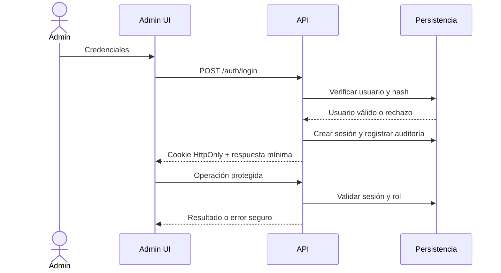

# 17. Seguridad y control de acceso

## Estado

Controles recomendados para el futuro MVP-1 técnico. La demo actual no tiene backend, autenticación ni datos persistidos. No se afirma cumplimiento normativo ni seguridad de producción.

## 1. Principios

- La demo usa datos ficticios y `DEMO_MODE=true`.
- El servidor será la frontera de confianza: toda autorización y validación se repite en backend.
- No se solicitan DNI, diagnósticos, antecedentes, medicamentos, radiografías ni otros datos clínicos.
- No se guardan secretos en el repositorio ni en variables `VITE_*`.
- Los errores públicos no revelan trazas, consultas, existencia de usuarios ni secretos; cada respuesta lleva un `requestId`.

## 2. Autenticación administrativa

Se recomienda sesión gestionada en servidor:

- contraseña almacenada únicamente como hash Argon2id, con parámetros revisados y actualizados según la biblioteca elegida;
- cookie `HttpOnly`, `Secure` en entornos con HTTPS y `SameSite` apropiado;
- token aleatorio almacenado solo en forma de hash, expiración absoluta, expiración por inactividad y revocación explícita;
- mensaje genérico ante credenciales incorrectas y limitación de intentos por cuenta y origen;
- cierre de sesión que revoque la sesión en el servidor;
- renovación de sesión después de autenticación para evitar fijación de sesión.

## 3. Autorización

Roles mínimos propuestos:

| Rol | Alcance |
| --- | --- |
| `admin` | Configuración, usuarios autorizados, catálogo, horarios y solicitudes. |
| `operator` | Revisar, confirmar, reprogramar o cancelar solicitudes según permisos asignados. |
| `editor` | Editar servicios y perfiles demostrativos sin administrar autenticación. |

La autorización se comprueba por endpoint y por recurso. Ocultar un botón en React no es una medida de control de acceso.

## 4. Protección de solicitudes

- Validar JSON Schema en servidor: tipos, longitudes, formatos, enumeraciones y relaciones entre campos.
- Aplicar protección CSRF a mutaciones autenticadas basadas en cookie.
- Mantener CORS en una lista explícita de orígenes; no usar `*` con credenciales.
- Escapar contenido al renderizar; no introducir HTML arbitrario ni habilitar `dangerouslySetInnerHTML` sin revisión específica.
- Usar consultas parametrizadas mediante el repositorio; no concatenar SQL.
- Aplicar límites de cuerpo, paginación, rate limit y timeouts.
- Configurar CSP, `frame-ancestors`, `Referrer-Policy`, `X-Content-Type-Options` y HTTPS en el entorno comercial.
- No habilitar subidas, pagos ni integraciones externas en el MVP-1.

## 5. Auditoría y observabilidad

Registrar, sin secretos ni datos clínicos:

- login exitoso y fallido, logout y revocación;
- creación, edición, publicación y archivado de servicios/profesionales;
- cambios de disponibilidad;
- revisión, confirmación, reprogramación y cancelación de solicitudes/citas;
- cambios de configuración y permisos.

Los logs operativos deben redaccionar cookies, contraseñas, tokens, payloads de contacto y cualquier dato que no sea necesario para diagnosticar. Las respuestas incluyen un identificador correlacionable con el evento de auditoría.

## 6. Separación demo/comercial

La demo debe tener configuración, fixtures, base de datos y credenciales administrativas separadas de cualquier entorno futuro. Los seeders demo no deben reutilizar datos reales. `DEMO_MODE` debe bloquear el envío real de notificaciones y la creación de integraciones de pago.

Para una eventual operación en Perú se requerirá una revisión específica de privacidad, retención, derechos de titulares, contratos con proveedores, cifrado, copias de seguridad y respuesta a incidentes. Este documento no constituye una declaración de cumplimiento.

## 7. Variables sensibles previstas

Solo como nombres de configuración, sin valores en el repositorio: `SESSION_SECRET`, `DATABASE_URL`, `CORS_ORIGIN`, `ADMIN_BOOTSTRAP_SECRET` temporal, credenciales de proveedor futuro y claves de observabilidad. Las variables públicas de Vite nunca deben contener secretos.

## 8. Riesgos residuales

La selección de biblioteca de hash, parámetros de sesión, proveedor de secretos, límites de retención y modelo de permisos requieren aprobación técnica antes de operar. No se han ejecutado análisis dinámicos ni pruebas de seguridad.

