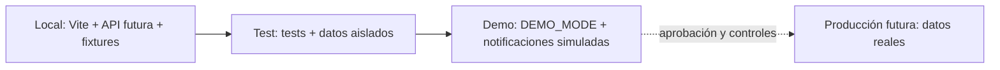

# 19. Infraestructura y entornos

## Estado

Propuesta de entornos y operación. No se ha seleccionado proveedor, no se ha desplegado nada y no se han configurado servicios externos.

## 1. Separación de entornos



| Entorno | Propósito | Datos e integraciones |
| --- | --- | --- |
| `local` | Desarrollo y revisión | Fixtures sintéticos; sin proveedores externos. |
| `test` | Unitarias e integración | Base o repositorio aislado; datos generados; limpieza por prueba. |
| `demo` | Presentación comercial | `DEMO_MODE=true`, Perú/PEN, `America/Lima`, notificaciones simuladas, sin pagos ni mensajes reales. |
| `production` futuro | Operación aprobada | Datos reales solo después de revisión de privacidad, seguridad, infraestructura y soporte. |

La demo no debe compartir base de datos, credenciales, buckets, colas ni dominios administrativos con producción.

## 2. Configuración prevista

Nombres de variables, sin valores ni secretos en el repositorio:

```text
APP_ENV
DEMO_MODE
COUNTRY_CODE=PE
CURRENCY_CODE=PEN
TIME_ZONE=America/Lima
DATABASE_URL              # solo donde exista persistencia autorizada
SESSION_SECRET
CORS_ORIGIN
LOG_LEVEL
NOTIFICATION_MODE=simulated
```

Proveedores de correo, pagos, almacenamiento o telemetría no se configuran en el MVP-1. Sus variables solo se podrían añadir después de una decisión explícita y un adaptador aislado.

## 3. Datos, migraciones y despliegue

- Las fixtures demo se versionan como datos sintéticos y reproducibles.
- Las migraciones se revisan en SQL, se prueban contra una base aislada y se ejecutan con backup y rollback definidos.
- Los backups futuros deben cifrarse, probarse mediante restauración y tener retención aprobada.
- La aplicación debe exponer health checks sin revelar configuración ni secretos.
- Logs estructurados, métricas básicas y alertas se definen antes de recibir datos reales.
- Dominio, HTTPS, cabeceras seguras y rotación de secretos son requisitos de producción, no de esta fase.

## 4. Criterios de promoción

No se promueve una demo a producción si:

- `DEMO_MODE` no está desactivado de forma verificable;
- se mezclan fixtures con datos reales;
- no existen backups restaurables, control de acceso y auditoría;
- siguen habilitadas notificaciones simuladas donde se esperan comunicaciones reales;
- faltan decisiones sobre privacidad, retención, soporte, dominio y proveedores;
- build, pruebas, revisión de accesibilidad y revisión de seguridad no tienen evidencia.

## 5. Decisiones pendientes

Proveedor de hosting, PostgreSQL gestionado, gestor de secretos, observabilidad, estrategia de despliegue, dominio y presupuesto quedan pendientes. No se asignan costos ni disponibilidad sin una investigación específica y actualizada.

