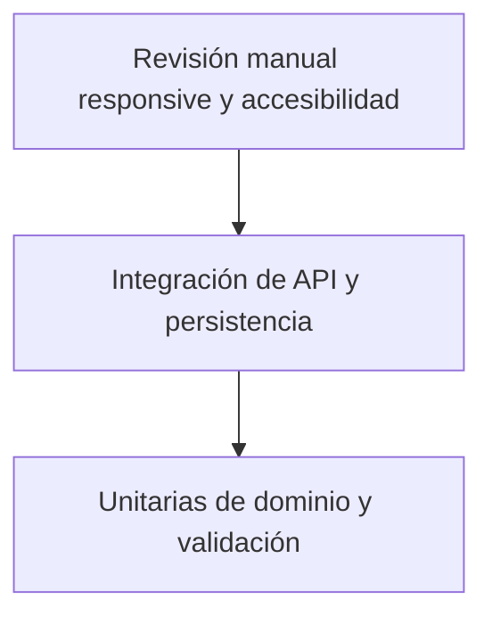

# 20. Testing y criterios de calidad

## Estado

Estrategia propuesta; no se ejecutaron build, tests, servidor ni pruebas de navegador durante esta fase documental. El proyecto conserva Vitest y actualmente solo hay dos pruebas de validación en `src/lib/validation.test.ts`.

## 1. Pirámide prevista

La automatización de navegador no se añade ahora. Las comprobaciones visuales de escritorio y móvil requieren una fase autorizada con navegador real.

## 2. Matriz de pruebas

| Área | Casos mínimos | Evidencia requerida |
| --- | --- | --- |
| Validación | nombre, email, servicio, límites, mensajes y estados de error | Tests unitarios Vitest. |
| Dominio | estados de solicitud/cita, cancelación, reprogramación y separación de pago | Tests unitarios de reglas. |
| Disponibilidad | zona horaria, límites, bloqueos, franjas y día no disponible | Unitarias e integración. |
| Concurrencia | dos confirmaciones sobre el mismo profesional/intervalo | Prueba de transacción y restricción. |
| API | contratos, errores, auth, paginación, idempotencia y request ID | Integración HTTP contra app aislada. |
| Autenticación | login, logout, expiración, revocación, CSRF y rate limit | Integración de sesión. |
| Autorización | permisos por rol y acceso a recursos | Casos permitidos y denegados. |
| Panel | filtros, estados vacíos, reintentos, confirmación y cambios controlados | Tests de comportamiento de componentes. |
| Notificaciones | eventos simulados, sin envío externo ni datos sensibles | Integración con adaptador fake. |
| Aislamiento | fixtures demo no acceden a producción ni guardan datos reales | Revisión de configuración y pruebas de entorno. |
| Responsive/a11y | 1440×900, 1024×768, 390×844, 375×812, teclado, foco y contraste | Revisión manual con navegador y herramientas a11y. |

## 3. Criterios de calidad

- No se marca PASS una comprobación que no se haya ejecutado.
- `npm test` y `npm run build` deben ejecutarse en una fase autorizada y registrarse con su salida real.
- Las pruebas no deben borrar ni debilitar casos para obtener un resultado verde.
- Los tests de API usan datos sintéticos y un entorno aislado.
- Los contratos de error y estados se prueban tanto en éxito como en fallo.
- La revisión manual debe comprobar imágenes, fuentes, menú, FAQ, formulario, foco, áreas táctiles y ausencia de desbordamiento.
- La revisión de seguridad debe separar vulnerabilidades confirmadas de riesgos pendientes de comprobar.

## 4. Definición de terminado del MVP-1 técnico

El MVP-1 técnico solo puede considerarse listo cuando el alcance funcional aprobado esté implementado, los contratos sean verificables, los estados de disponibilidad sean seguros, exista control de acceso administrativo, la demo siga aislada, las pruebas y build tengan evidencia, y la revisión visual/a11y esté documentada.

En el estado actual, solo existe la demo frontend y su cobertura de validación documentada; no se afirma cumplimiento de los criterios futuros.

